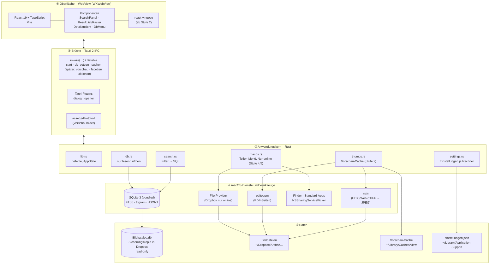
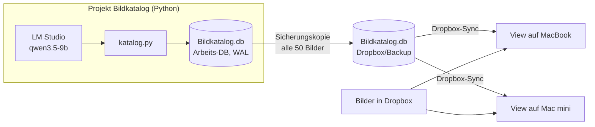
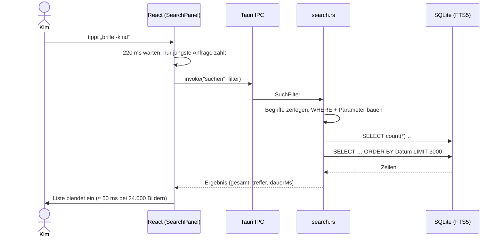
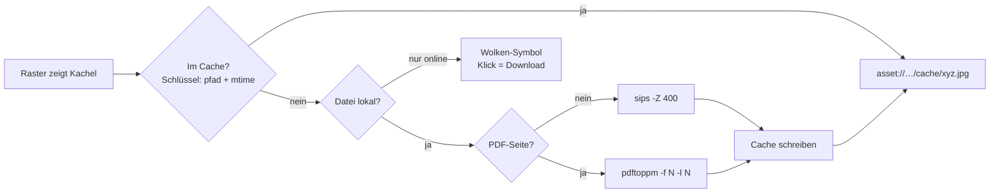

# Bilderwerk View – Technologie- und Architekturkonzept

**Stand:** November 2026 · **Version:** 1.0 (nach Stufe 1)

## 1. Ziel und Rahmen

Bilderwerk View (View) ist eine Desktop-App für macOS, die den KI-erzeugten Bildkatalog
(SQLite-Datenbank aus dem Projekt *Bildkatalog*) komfortabel durchsuchbar macht:

- kombinierbare Suche: Freitext über Dateiname, Ordner, KI-Beschreibung und Metadaten,
  dazu Dateiname, Ordner, Datum, Dateityp und später die KI-Kategorien
- Trefferliste bzw. -raster mit Vorschaubildern, schrittweise weiter einschränkbar
- Detailansicht mit Bild und allen Daten, dazu Öffnen, Im Finder zeigen, Sichern unter … und Teilen

**Rahmenbedingungen**

| Punkt | Festlegung |
|---|---|
| Nutzer | Einzelanfertigung, ein Anwender |
| Aufwand | höchstens eine Woche, umgesetzt in 6–7 Stufen, je Stufe in einem Zug |
| Plattform | macOS (MacBook Air M3, Mac mini M1) |
| Datenquelle | Sicherungskopie der Katalog-DB in Dropbox, damit beide Rechner sie nutzen können |
| Auslieferung | eigenständige `.app` / `.dmg` |
| Gestaltung | ruhig und klar, Start auf leerer Fläche nur mit Suchfeld, ohne Platzhalter |

## 2. Technologieentscheidung

| Option | Bewertung |
|---|---|
| **Tauri 2 + React + Rust** ✅ | Natives Binary (~10 MB), moderne Oberfläche, bewährt aus PaperTrail Compare. SQLite und FTS5 direkt in Rust, ohne Python-Laufzeit. Gut in einer Woche machbar, weil Schema, Volltextindex und Vorschau-Befehle schon im Katalog-Projekt vorliegen. |
| tkinter (Python) | Schnell begonnen, aber ein Bilderraster mit 20.000 virtualisierten Vorschaubildern, Animationen und Teilen-Menü ist mühsam. Die Optik bleibt altbacken. |
| SwiftUI | Sehr nativ, aber mehr Aufwand bei Raster, Filtern und Layout, und kein Bezug zum vorhandenen Tauri-Wissen. |
| Python-Backend als Tauri-Sidecar | Unnötige zweite Laufzeit. Rust deckt alles ab. |

## 3. Schichtenarchitektur



| Schicht | Aufgabe | Technik |
|---|---|---|
| ① Oberfläche | Darstellung, Eingabe, Animation; hält keine Fachlogik | React 19, TypeScript, Vite, reines CSS (hell/dunkel) |
| ② Brücke | typisierte Aufrufe zwischen UI und Kern, Systemdialoge | Tauri 2 `invoke`, Plugins `dialog` und `opener`, `asset://` |
| ③ Kern | Suche, DB-Zugriff, Vorschau, Systemaktionen | Rust, `rusqlite` (SQLite eingebaut), `serde` |
| ④ System | Bildkonvertierung, Finder, Teilen, Dropbox | macOS-Bordmittel, Homebrew `poppler` |
| ⑤ Daten | Katalog (fremd, nur lesend), eigene Cache- und Konfigurationsdaten | SQLite-Datei, Dateisystem |

## 4. Zusammenspiel mit dem Projekt *Bildkatalog*



- View **ändert nie** etwas an der Katalog-DB und **verändert das Schema nicht**.
- Geöffnet wird mit `mode=ro&immutable=1`: keine Sperren, keine `-wal`/`-shm`-Dateien in Dropbox.
- Ersetzt Dropbox die Datei, öffnet View sie neu (Stufe 5). Das DB-Menü zeigt den Stand der Sicherung.
- Eigene Daten (später z. B. Favoriten und Sammlungen) kommen in eine **eigene** `view.db`, verknüpft über `bilder.pfad`.

## 5. Ablauf einer Suche



### Facetten (`facetten.rs`, ab v0.0.5)

| Punkt | Umsetzung |
|---|---|
| Felder | fest hinterlegt: Spalten `motiv`, `bildart`, `farbgebung`, `ausrichtung`, `jahreszeit`, `wetter`; Begriffe `merkmal`, `schlagwort` (Tabelle `begriffe`) – nur diese Namen gelangen in SQL |
| Auswahl | `SuchFilter.facetten` (Feld → Werte): innerhalb ODER (`IN`), zwischen Facetten UND |
| Zählung | disjunktiv: jede Facette zählt mit allen Kriterien außer ihrer eigenen Auswahl; Begriffe Top 40; gewählte Werte bleiben (auch mit 0) |
| Ohne Suchtext | Facetten zählen über den ganzen Katalog (Stöbern); eine Auswahl startet die Suche |
| Ältere Kataloge | fehlende Spalten → Facette entfällt; Auswahl darauf → 0 Treffer statt SQL-Fehler |

### Suchlogik (`search.rs`)

| Kriterium | Umsetzung |
|---|---|
| Freitext ≥ 3 Zeichen | `id IN (SELECT rowid FROM suche WHERE suche MATCH '"wort"')` (Trigram: Wortteile, Komposita) **oder** Archiv-Wurzel enthält das Wort |
| Freitext < 3 Zeichen | `instr(lower(…))` auf Dateiname, Kurztitel, Beschreibung, Schlagworte |
| `"Phrase"`, `-wort` | Phrase bleibt zusammen; `-` setzt `NOT` davor |
| Dateiname, Ordner | Teilstring, ohne Groß-/Kleinschreibung |
| Datum von/bis | String-Vergleich auf ISO-Datum; „bis 2015“ wird zu `<= '2015Z'` |
| Dateityp | Gruppen (JPEG = .jpg + .jpeg …) → `endung IN (…)` |
| Duplikate | Standard `status = 'ok'`, wahlweise auch `'duplikat'` |
| Sortierung | plausibles Datum absteigend; ungültige (z. B. `2056-55-10`) und fehlende Datumswerte ans Ende |

Alle Werte gehen als **gebundene Parameter** in die Abfrage, nie als zusammengesetzter SQL-Text.

## 6. Vorschaubilder (Stufe 2)



- Vorschauen entstehen **erst, wenn eine Kachel sichtbar wird**, parallel mit begrenzter Zahl gleichzeitiger Jobs. Ein Vorab-Lauf über alle Bilder entfällt.
- Für die Detailansicht gibt es eine größere Vorschau (ca. 1600 px). Die WebView bekommt so immer JPEG zu sehen und muss HEIC, TIFF oder PDF nicht selbst darstellen können.

## 7. Konfiguration und Geheimnisse

| Datei | Im Repo | Inhalt |
|---|---|---|
| `view.local.example.json` | ja | Vorlage |
| `view.local.json` | **nein** (`.gitignore`) | lokale Pfade, z. B. Vorschlag für die DB |
| `einstellungen.json` (App-Support) | nein | gewählter DB-Pfad je Rechner |

`build.rs` liest `view.local.json` beim Build und gibt den Wert per `option_env!` an den Code weiter.
Fehlt die Datei, baut die App trotzdem. Beim ersten Start fragt sie dann nach der Datenbank.

## 8. Projektstruktur

```
Bilderwerk View/
├── docs/ARCHITEKTUR.md
├── view.local.example.json      (view.local.json – lokal, ignoriert)
├── package.json · vite.config.ts · tsconfig.json · index.html
├── src/                        React-Oberfläche
│   ├── App.tsx  api.ts  types.ts  styles.css
│   └── components/  SearchPanel · ResultList · DbMenu
└── src-tauri/                  Rust-Kern
    ├── build.rs  Cargo.toml  tauri.conf.json
    ├── capabilities/default.json
    ├── icons/  app-icon.svg  app-icon.png
    └── src/  lib.rs  search.rs  db.rs  settings.rs
```

## 9. Umsetzungsplan

| Stufe | Inhalt | Status |
|---|---|---|
| 1 | Grundgerüst, Einstellungen, DB nur lesend, Suche (Freitext + Basisfilter), leere Startfläche | ✅ |
| 2 | Vorschau-Cache (`sips` / `pdftoppm`), virtualisiertes Raster | ✅ |
| 2b | **v0.0.3:** Anbieter-Schnittstelle `Speicheranbieter` (lokal · File Provider · Dropbox-API), Zuordnung per Pfad-Anfang, Cache-Obergrenze, Testinfrastruktur (Test-DB, Vitest, Vertragstests) – siehe `docs/intern/Übergabe v0.0.3.md` (intern, nicht im Repo) | ✅ |
| 3 | **v0.0.5:** Facetten mit Anzahl (Motiv, Bildart, Farbgebung, Ausrichtung, Jahreszeit, Wetter, Merkmale, Schlagworte), Chips – `facetten.rs`, disjunktive Zählung; dazu ganzes Bild in Kachel/Liste und HEIC über die Dropbox-Vorschau-API | ✅ |
| 4 | Detailansicht, Öffnen, Im Finder zeigen, Sichern unter …, Teilen-Menü | |
| 5 | Nur-online-Dateien erkennen und laden, DB neu laden bei Änderung, Tastatur | |
| 6 | Feinschliff, `.app`/`.dmg`-Build, Test auf beiden Macs | |
| 7 | Duplikat-Bereinigung: Duplikate mit Original gegenüberstellen, Duplikat-Datei + DB-Eintrag entfernen (Schreibzugriff auf die **Arbeits-DB** – eigene, abgesicherte Funktion) · Puffer | |

## 10. Risiken und Gegenmaßnahmen

| Risiko | Maßnahme |
|---|---|
| Dropbox-Datei liegt nur online | erkennen (keine belegten Datenblöcke), Wolken-Symbol, Download per Klick |
| DB-Sicherung wird während der Nutzung ersetzt | `immutable`-Öffnung, Änderungszeit beobachten, neu öffnen |
| Unplausible Aufnahmedaten im Katalog | ans Ende sortieren; eigentliche Korrektur gehört in `metadaten.py` |
| Große Treffermengen | Begrenzung auf 3.000 plus Gesamtzahl, virtualisiertes Raster |
| `pdftoppm` fehlt | Hinweis in der App, PDF-Vorschau entfällt |
| `node_modules` / `target` in Dropbox | per `xattr com.dropbox.ignored` ausschließen |

## 11. Ausblick (nach Woche 1)

- eigene `view.db` für Favoriten und Sammlungen (Collagen-Listen)
- semantische Suche über Embeddings (`nomic-embed-text` in LM Studio)
- Ortsnamen aus GPS, Personen aus Apple Fotos, sobald der Katalog sie liefert
